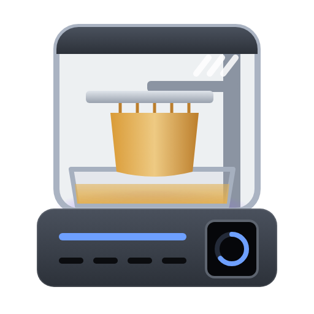
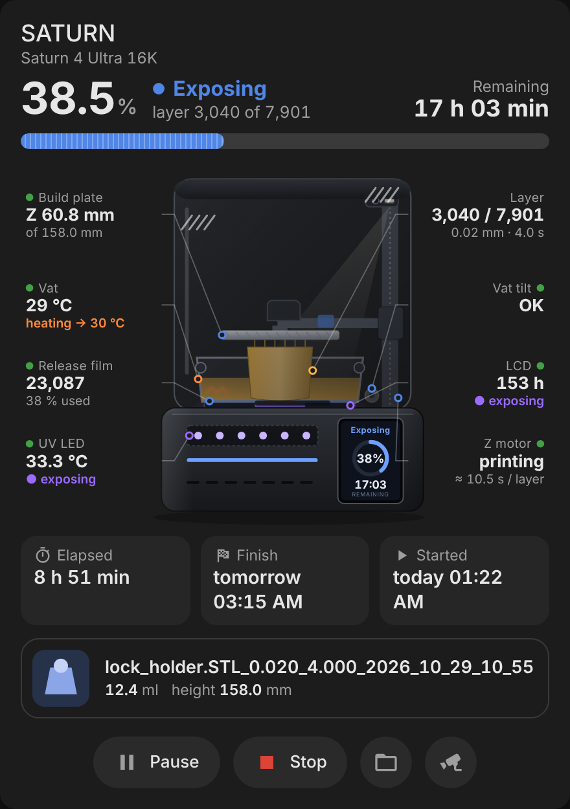
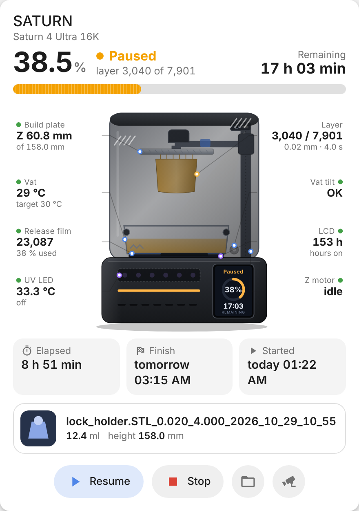
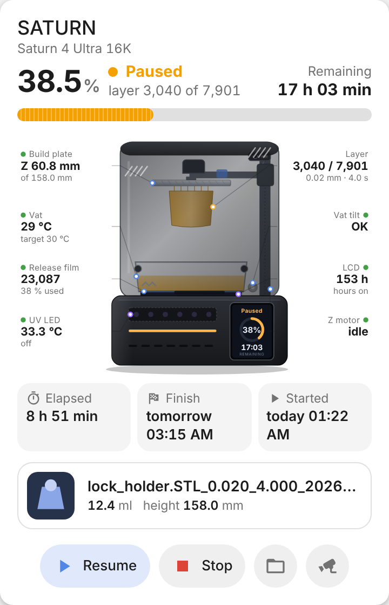
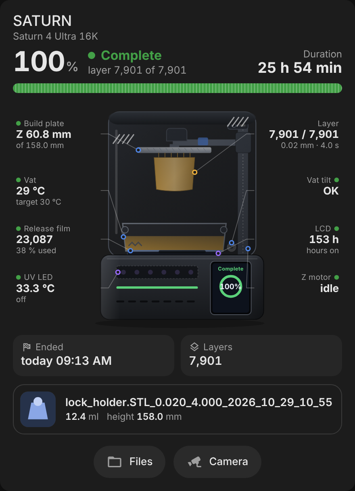
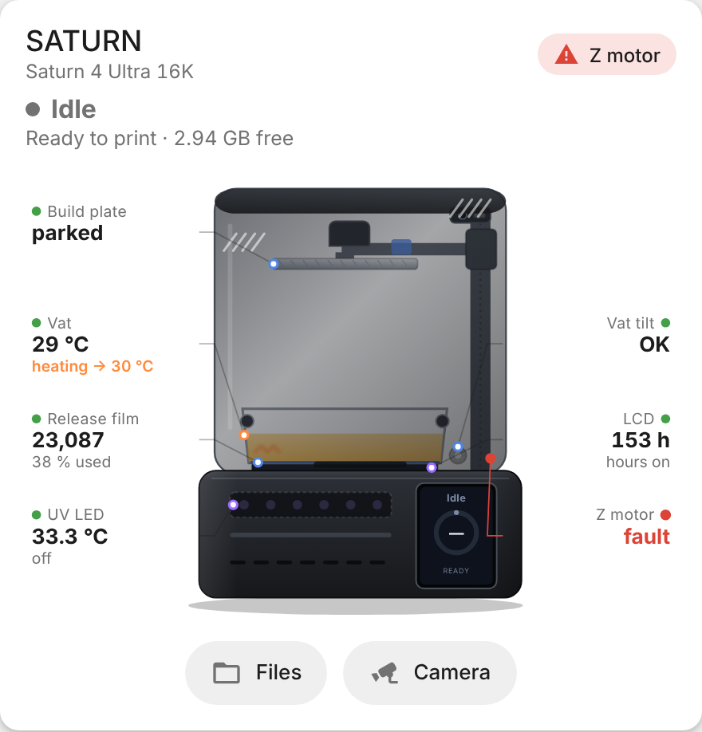
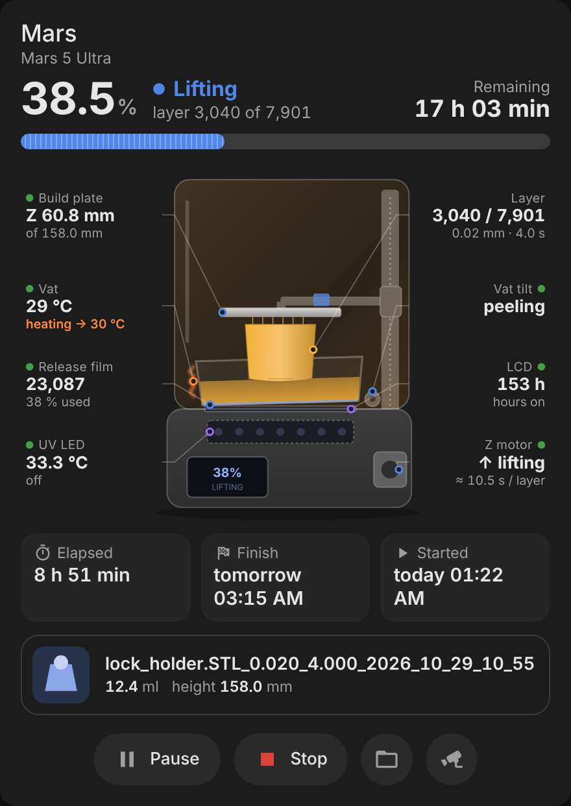
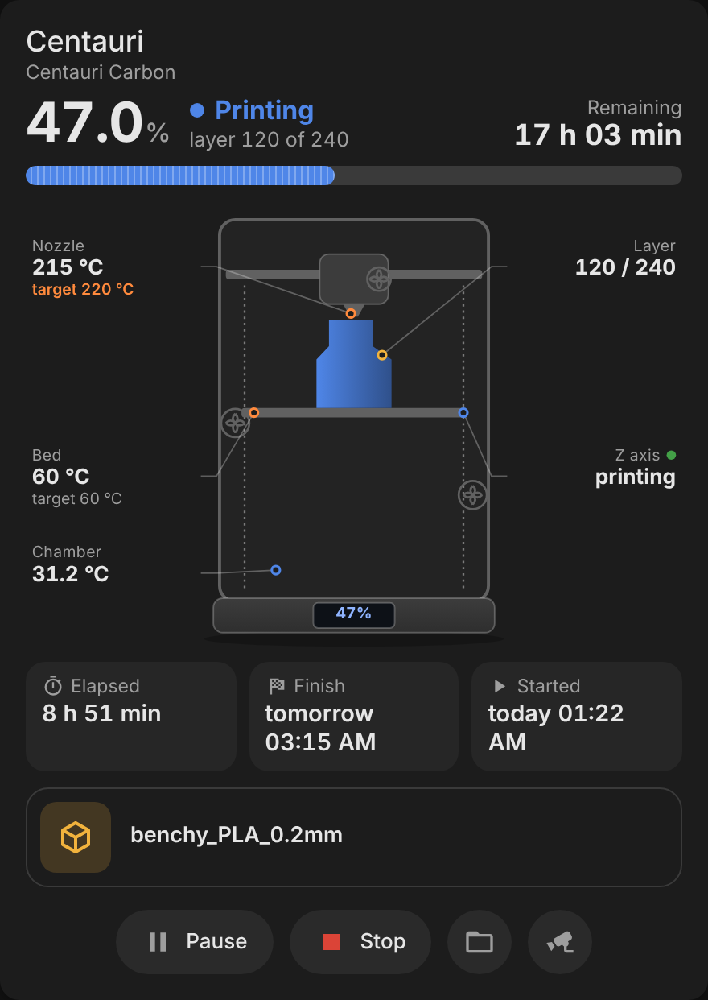
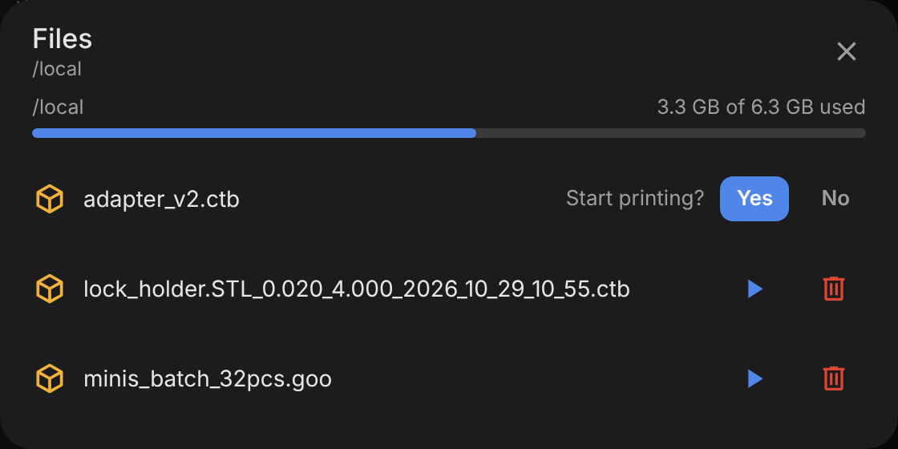

# SDCP Printer Card

A Lovelace card for 3D printers on the **SDCP** protocol (ELEGOO Saturn / Mars / Jupiter resin
printers, Centauri Carbon and other Chitu boards). It needs the
**[SDCP 3D Printer integration](https://github.com/pollstar/ha-sdcp)**.

<p>
  
  
</p>

## One drawing per printer

The integration recognises the printer model and reports a drawing profile
(`printer_profile` on the *machine state* sensor). The card then downloads **only that
printer's drawing** — a small module next to the card:

| Profile | File | Printers |
|---|---|---|
| `saturn-4-ultra` | `sdcp-printer-saturn-4-ultra.js` | ELEGOO Saturn 4 Ultra / 16K |
| `generic-resin` | `sdcp-printer-generic-resin.js` | other resin (MSLA) printers |
| `generic-fdm` | `sdcp-printer-generic-fdm.js` | FDM printers (Centauri Carbon…) |

With an older integration that does not report a profile, the card picks it from the
device model, and falls back to the generic resin or FDM drawing. `printer:` in the card
config forces a drawing.

The card draws the printer itself and puts every reading next to the part it belongs to.

- **Status strip on top** — progress in %, the current operation (exposing, lifting,
  paused…) with the layer, and the time left, over a layer-stripe progress bar.
- **`saturn-4-ultra` — styled after the ELEGOO Saturn 4 Ultra 16K** — black metal base, smoked flip-up
  lid with white hatching, the AI camera with its light on the Z column, build plate with
  the laser-engraved surface and the lever, vat with thumbwheels and heater, release film,
  LCD and UV-LED matrix, tilt motor, and the **vertical touchscreen** on the front that
  mirrors the printer: operation, progress ring and time left.
  - The plate really moves: it rises with the printed Z height, lifts during the *lifting*
    stage, parks at the top on pause / completion, and the printed model hangs under it on
    its supports.
  - While exposing the LCD shows the layer and the UV matrix glows; the camera light comes
    on while printing; the heater turns orange while the vat is heating; the vat tilts
    slightly while peeling; the front light strip follows the state colour.
  - Callouts: plate (Z height of the model height), vat temperature and target, release-film
    cycles and wear, UV-LED temperature and state, current layer with layer height and
    exposure, vat tilt, LCD hours, Z motor (moving / holding, seconds per layer).
- **`generic-fdm`** (Centauri Carbon and other FDM boards) — enclosure, gantry, toolhead with the part fan, nozzle
  glowing when hot, bed that moves down as the model grows, side and chamber fans spinning
  when on; callouts for nozzle, bed, chamber, fans, layer and the Z axis.
- **`generic-resin`** — any other MSLA printer: amber lid, Z column, plate, vat, film, LCD and
  UV matrix, with the same moving plate and callouts.
- **Self-test on the parts** — each callout has a dot for its self-test check (load cell,
  vat, film, UV sensor, tilt motor, LCD, Z motor); a failing check turns the callout and its
  leader red and also shows in the header.
- **Below the printer** — elapsed, finish and start time, the job (model preview, resin volume and weight, bottom layers, model height),
  print errors, and the controls: pause / resume, stop (needs a second tap), file browser
  (start or delete a print with an inline confirmation, storage usage on top) and camera.
- English, French, German, Spanish, Ukrainian or Russian after the HA UI language (English for
  others); light, dark or auto theme.
  Tap any reading or part label for its entity's more-info.

<p>
  
  
  
</p>
<p>
  
  
</p>
<p></p>

## Install

1. Install and set up the [SDCP 3D Printer integration](https://github.com/pollstar/ha-sdcp).
2. HACS → ⋮ → Custom repositories → `https://github.com/pollstar/sdcp-printer-card`, category
   **Dashboard** → install. HACS adds the dashboard resource itself.
3. Reload the browser (Ctrl+F5).
4. Dashboard → Edit → Add card → **SDCP 3D Printer**, or:

```yaml
type: custom:sdcp-printer-card
device: 0123abcd...        # optional; the first SDCP printer by default
title: Saturn              # optional
printer: auto              # auto | saturn-4-ultra | generic-resin | generic-fdm | <your drawing>
drawings:                  # optional, extra drawing modules: id -> URL
  my-printer: /local/sdcp-printer-my-printer.js
theme: auto                # auto | light | dark
show_controls: true
show_files: true
show_camera: true          # shown only when the camera entity is enabled
show_health: true          # self-test dots on the parts
```

Manual install: copy every file from `dist/` into `config/www/sdcp-printer-card/` and add
the resource `/local/sdcp-printer-card/sdcp-printer-card.js` (type *JavaScript module*).
The drawings must stay next to the card file.

## Adding a printer

Drawings are plug-ins with a small stable API, so a printer can get its own look without
touching the core — in this repository or shipped separately:

```yaml
type: custom:sdcp-printer-card
drawings:
  acme-resin-9000: /local/sdcp-printer-acme-resin-9000.js
```

Start from [`examples/sdcp-printer-example.js`](examples/sdcp-printer-example.js), try it on
the dev page (`dev/`, no Home Assistant needed) and see [CONTRIBUTING.md](CONTRIBUTING.md).
Printer models on the integration side are described in
[ha-sdcp/CONTRIBUTING.md](https://github.com/pollstar/ha-sdcp/blob/main/CONTRIBUTING.md).

## License

[PolyForm Noncommercial 1.0.0](LICENSE.md) — free for personal and other noncommercial use.
